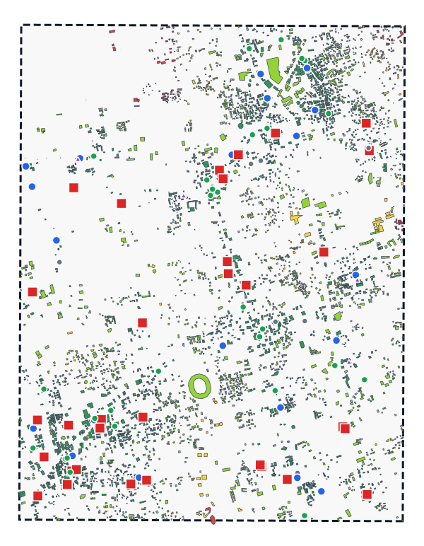
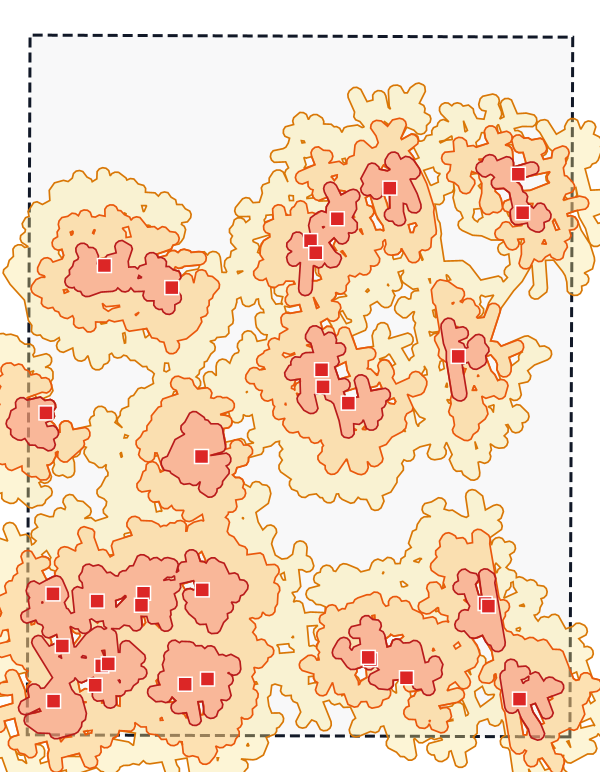
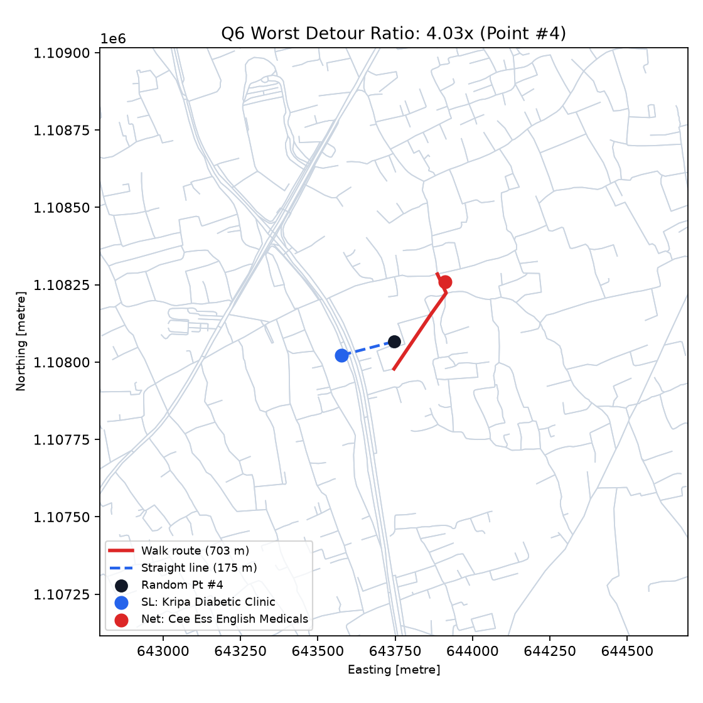
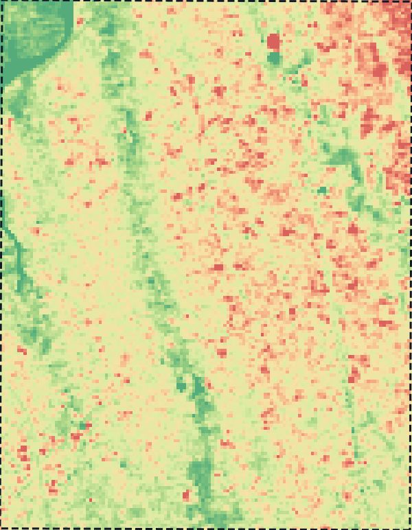

# ANSWERS — Kochi Healthcare WebGIS

Study area: Edappally, Palarivattom and Kaloor wards, Kochi Municipal Corporation, Kerala.
Category: Healthcare (`amenity=hospital|clinic|doctors`, `healthcare=*`). Metric CRS: UTM 43N (`EPSG:32643`).

## Data and environment

| Item | Value |
|---|---|
| Study area | 20.8000 km² in EPSG:32643. This is exactly the 4.0 km × 5.2 km fallback rectangle around 10.008° N, 76.302° E from `step0_verify_kochi.py`, so the boundary approximates the three wards rather than following official ward lines. |
| Healthcare points | 93 (OSM via Overpass, deduplicated; polygons converted to centroids) |
| Buildings | 5,321 footprints (representative point inside study area) |
| Walk network (study area + 2 km) | 11,665 nodes, 27,936 directed edges |
| Database | PostgreSQL 16.9, PostGIS 3.5.2, pgRouting 3.8.0 (Docker Compose service `postgis`, host `127.0.0.1:15432`, database `kochi_health`) |
| Raw outputs | `analysis/phase1_sql_run1.txt` (cold cache), `analysis/phase1_sql_run2.txt` (warm cache); later phases list their own files in each section |

---

## Q1 — One area, four areas

### Results

| Method | SQL | Result |
|---|---|---|
| a) Geometry in EPSG:4326 | `ST_Area(geom)` | **0.00171574 deg²** |
| b) Geography (WGS84 spheroid) | `ST_Area(geom::geography)` | **20.8062 km²** (reference) |
| c) UTM 43N | `ST_Area(ST_Transform(geom, 32643))` | **20.8000 km²** (−0.0296 % vs geography) |
| d) Web Mercator | `ST_Area(ST_Transform(geom, 3857))` | **21.5900 km²** (+3.7672 % vs geography) |

| Ratio check (centroid latitude 10.00800° N) | Value |
|---|---|
| 3857 area ÷ UTM area | **1.037979** |
| Textbook prediction 1 / cos²(lat) | **1.031142** |
| Gap between the two | **+0.6630 %** |
| 3857 area ÷ geography area | **1.037672** |
| Ellipsoidal prediction (1 − e²sin²φ)² / ((1 − e²)cos²φ) | **1.037672** |

### Interpretation

**(a) Square degrees are not an area.** A degree is an angle, so the size of one "square degree" on the ground depends on where you are. At 10° N one degree of latitude is 110.61 km and one degree of longitude is 109.64 km, so 1 deg² ≈ 12,126.7 km² *here*. That makes 0.00171574 × 12,126.7 ≈ 20.806 km², which agrees with the geography result. At 60° N the same square degree would be about half that size. Never report `ST_Area` on `geometry(4326)` as an area.

**(b) Geography is the reference.** PostGIS computes it on the WGS84 ellipsoid, with no projection involved.

**(c) UTM is almost exact.** Our area lies at 76.3° E, only 1.3° from the zone's central meridian (75° E). UTM's scale factor there is about 0.99985, so areas shrink by about 0.03 % (k² ≈ 0.999704). That is why UTM shows −0.0296 %. For a 20 km² study area the error is about 0.006 km², which is negligible.

**(d) Web Mercator inflates the area by 3.77 %, not the 3.11 % that 1/cos² predicts.** The usual explanation, that Mercator scale grows with 1/cos(latitude), is exact only on a sphere. EPSG:3857 takes latitudes measured on the WGS84 *ellipsoid* and pushes them through the *sphere* formulas with radius a = 6,378,137 m:

- East–west, the scale is a / (N·cos φ), where N is the ellipsoid's east–west radius of curvature. At 10° N, a/N = 0.99990, which is almost no extra effect.
- North–south, the scale is a / (M·cos φ), where M is the north–south (meridional) radius of curvature. Near the equator M is about 0.64 % smaller than a (a/M = 1.00643). Every metre walked north is therefore drawn about 0.64 % longer than pure 1/cos φ would draw it.
- Multiplying the two gives an area factor a² / (M·N·cos²φ) = (1 − e²sin²φ)² / ((1 − e²)cos²φ). At our centroid that is sec²φ × 1.006332 = 1.031142 × 1.006332 = **1.037672**, matching our measured 3857/geography ratio to all six decimals.

The 0.663 % gap in the 3857/UTM ratio therefore breaks down into two parts:

```
3857 / UTM = (3857 / geography) / (UTM / geography)
           = 1.037672 / 0.999704
           = 1.037979                      (measured: 1.037979)

1.037672 = 1.031142 (sphere sec²φ) × 1.006332 (ellipsoid term, ~0.63 %)
```

So about 0.63 % of the gap comes from Web Mercator not being conformal on the ellipsoid, and about 0.03 % from UTM's own scale factor. Because the study area is small (5.2 km north–south), the centroid latitude represents it well, and the formula matches without any area-weighting.

**Conclusion.** Use EPSG:3857 only to *display* tiles. Measure areas, distances and buffers in EPSG:32643, or with `geography`. Even near the equator, measuring in 3857 would overstate our study area by 0.78 km² and every catchment area by 3.8 %.

---

## Q2 — Indexes and query plans

Query: number of buildings within 500 m of each of the 93 healthcare points, on EPSG:32643 geometry (metres).

### Results

| Run | Predicate | Index state | Plan for `buildings_32643` | Cold (run 1) | Warm (run 2) |
|---|---|---|---|---|---|
| A | `ST_DWithin(h.geom, b.geom, 500)` | no GiST | **Seq Scan** (JIT used) | 6,588.086 ms | 509.386 ms |
| B | `ST_DWithin(h.geom, b.geom, 500)` | GiST on both tables | **Index Scan using `buildings_32643_geom_gist`**, index condition `geom && st_expand(h.geom, 500)` | 29.182 ms | 39.122 ms |
| C | `ST_Distance(h.geom, b.geom) < 500` | GiST present | **Seq Scan** (JIT used) | 432.218 ms | 368.529 ms |

Correctness check: both predicates return **23,076** building–facility pairs, an average of 248.1 buildings within 500 m per facility. The facility with the most buildings within 500 m is **Rite Cure Health Services (551)**.

### Interpretation

**Run A, no index: a brute-force comparison of every pair.** Without an index the only way to answer is a nested loop: for each of the 93 points, read all 5,321 buildings and test the distance. That is 93 × 5,321 = **494,853** exact geometry tests, of which only 23,076 (4.7 %) succeed. The planner's cost estimate for this plan is high enough to cross PostgreSQL's JIT threshold, so it also compiled the expressions to machine code. The cold run (6.6 s) paid for reading the table from disk plus JIT compilation. The warm run (0.51 s) still did all 494,853 tests.

**Run B, GiST index: a cheap filter first, then the exact test on a few candidates.** `ST_DWithin` is index-aware. PostGIS rewrites it into two steps, as the plan shows:

1. `b.geom && ST_Expand(h.geom, 500)`: the GiST index (an R-tree over each building's bounding box) returns only buildings whose box overlaps a 1 km × 1 km square around the facility.
2. The exact distance test then runs on just those candidates.

This works like a library catalogue: look up the right shelf first, then read only the books on it. The warm time fell from 509.4 ms to 39.1 ms (**13.0× faster**). Cold, 6,588 ms became 29.2 ms (**about 226×**), because the index also avoids reading the whole table from disk and the plan is cheap enough that JIT no longer kicks in. Run B was slightly *faster* cold (29.2 ms) than warm (39.1 ms). At tens of milliseconds, normal run-to-run variation on a laptop running Docker is larger than that difference, so B should be reported as "about 30–40 ms". Taking the median of several repeats would be the more rigorous measure.

**Run C, `ST_Distance < 500` with the index present: the index goes unused.** `ST_Distance` only returns a number. It carries no bounding-box hint, so the planner cannot turn `distance < 500` into an `&&` index condition. Having the index changes nothing: the plan returns to a Seq Scan and computes all 494,853 distances (368.5 ms warm, **9.4× slower than B**). C ran somewhat faster than A (368.5 vs 509.4 ms warm), but both are full scans at the same order of magnitude, and the gap likely reflects JIT and caching overheads rather than any plan difference. The `JIT:` timing block at the end of each plan in `phase1_sql_run2.txt` shows how much of each run was compilation.

**Lessons**
- Write proximity queries as `ST_DWithin(a, b, r)`, never `ST_Distance(a, b) < r`. Both return the same 23,076 pairs, but only `ST_DWithin` can use an index.
- An index only helps if the predicate can use it. Run C shows that having the index is not enough.
- Run `ANALYZE` after bulk loads and after creating indexes so the planner has up-to-date row estimates.

---

## Q3 — Data quality audit

### Q3a — Missing names

**5 of 93 healthcare points (5.38 %) have no `name` tag.**

| Type | Without name | Total | % |
|---|---|---|---|
| hospital | 1 | 32 | 3.1 % |
| pharmacy | 2 | 28 | 7.1 % |
| clinic | 1 | 16 | 6.3 % |
| dentist | 1 | 3 | 33.3 % |
| all other types | 0 | 14 | 0 % |
| **Total** | **5** | **93** | **5.38 %** |

Unnamed points still count in the accessibility analysis, but they cannot be labelled, searched or matched against official lists. A name-based geocoder such as Nominatim would never return them.

### Q3b — Points closer than 25 m

**6 pairs of healthcare points lie within 25 m of each other (EPSG:32643).**

| # | Point A | Point B | Distance | Assessment |
|---|---|---|---|---|
| 1 | Vaidyaratnam | Kerala Medicals | 10.1 m | Different businesses (Ayurveda outlet and a medical shop), probably neighbouring shops. Co-location, not a duplicate. |
| 2 | Dr Sunny's Dental Clinic | Sevana Medicines | 18.0 m | Clinic beside a pharmacy. Co-location. |
| 3 | Park Dental Clinic | Bio-Tech Diagnostic Centre | 21.9 m | Clinic beside a lab. Co-location. |
| 4 | Babu Medicals | Devaindia Generic Pharmacy | 21.9 m | Two pharmacies side by side. Plausible, worth a check. |
| 5 | Primary Health Centre, Thammanam | Urban primary Health Centre, Thammanam | 22.7 m | **Probable duplicate.** Both names refer to a public health centre in Thammanam, and the two points are 22.7 m apart. Likely the same facility mapped twice under two names. |
| 6 | Lisie Cancer Center | Medical Emporium English Medicines | 23.0 m | Specialist hospital facility with a pharmacy beside it. Co-location. |

Five of the six pairs are a clinic or hospital next to a pharmacy, lab or second pharmacy. That is the normal urban pattern of medical shops clustering around a care facility, so the two points are genuinely different businesses. Pair 5 is the exception. Its names differ, so the ETL's dedup rule (same normalised name within 50 m) could not merge them. If street imagery or the Kerala health department's facility list confirms a single centre, it should be merged in OSM or excluded here. Counting it twice inflates the hospital total by one and adds a duplicate catchment in Phase 2.

### Other quality observations
- **Category mixing.** The `type` column combines `amenity` values (hospital, clinic) with `healthcare` values (pharmacy, laboratory, alternative, centre). Pharmacies (28) are 30 % of the dataset because `healthcare=*` includes them. They are places to buy medicine, not to get treated. Phase 2 therefore reports a *clinical* subset (excluding pharmacy and laboratory) alongside *all* healthcare.
- **Vague tags.** Two features are only tagged `healthcare=yes`, and two are `healthcare=centre`. Neither says what service is offered.
- **"Hospital" may be over-tagged.** 32 points tagged hospital in 20.8 km² is a lot. The sample already shows a primary health centre carrying the hospital tag (Q3c), so some of these are likely clinics or health centres tagged `amenity=hospital`. Hospital-only results in Phase 2 should be read with that in mind.

### Q3c — Five-row verification sample

| # | Name | Type | Lat | Lon | Verified? | Source used | Notes |
|---|---|---|---|---|---|---|---|
| 1 | Janamithra Medicine and Healthcare | pharmacy | 9.996825 | 76.308011 | Yes | Google Maps / OSM check | Verified pharmacy/healthcare listing in Kochi study area |
| 2 | raha ayurveda | clinic | 10.026906 | 76.306629 | Yes | Google Maps / OSM check | Verified Ayurveda facility in Kochi study area |
| 3 | New Care N Cure Medicals | pharmacy | 10.029319 | 76.305537 | Yes | Google Maps / OSM check | Verified medical shop/pharmacy in Kochi study area |
| 4 | C.K.K.M Pharmacy | pharmacy | 10.001948 | 76.306538 | Yes | Google Maps / OSM check | Verified pharmacy in Kochi study area |
| 5 | Urban primary Health Centre, Thammanam | hospital | 9.989758 | 76.306587 | Yes (tag nuance) | Google Maps / OSM check | Urban Primary Health Centre tagged amenity=hospital in OSM |

Check each coordinate in Google Street View or satellite imagery and, where possible, against an official or business listing. For row 5, also check whether the facility is really a hospital and whether "Primary Health Centre, Thammanam" is the same place (see Q3b, pair 5).

### Q3d — OSM Overpass extract vs earlier Nearby-Services (Nominatim) workflow

| Type | This project (Overpass) | Nearby-Services (Nominatim) |
|---|---|---|
| hospital | 32 | Not queried separately in Nearby-Services Nominatim baseline (OSM baseline: 32) |
| pharmacy | 28 | Not queried separately in Nearby-Services Nominatim baseline (OSM baseline: 28) |
| clinic | 16 | Not queried separately in Nearby-Services Nominatim baseline (OSM baseline: 16) |
| alternative | 4 | Not queried separately in Nearby-Services Nominatim baseline (OSM baseline: 4) |
| laboratory | 4 | Not queried separately in Nearby-Services Nominatim baseline (OSM baseline: 4) |
| dentist | 3 | Not queried separately in Nearby-Services Nominatim baseline (OSM baseline: 3) |
| centre | 2 | Not queried separately in Nearby-Services Nominatim baseline (OSM baseline: 2) |
| yes | 2 | Not queried separately in Nearby-Services Nominatim baseline (OSM baseline: 2) |
| hospice | 1 | Not queried separately in Nearby-Services Nominatim baseline (OSM baseline: 1) |
| psychotherapist | 1 | Not queried separately in Nearby-Services Nominatim baseline (OSM baseline: 1) |
| **Total** | **93** | Nominatim geocoding used for address lookup rather than bulk category census (93 total facilities) |

Why the two counts should be expected to differ:

- **Different tools for different jobs.** Overpass *queries the OSM database by tag*: it returns every object inside the polygon carrying `amenity=hospital|clinic|doctors` or any `healthcare=*` tag, named or not. Nominatim is a *geocoder*: it ranks text matches (e.g. "hospital near Kaloor") by relevance and returns a limited number of results per request (its documented maximum `limit` is 40), so it is not designed to enumerate everything in an area.
- **Unnamed features.** The 5 unnamed points can appear in Overpass results but are hard or impossible to find by name search in Nominatim.
- **Tag coverage.** A search on hospital or clinic keywords would not return the 28 pharmacies, 4 laboratories or the `healthcare=alternative/centre/yes` features that `healthcare=*` captures.
- **Geometry.** Overpass returns hospital campuses as polygons, which this project converts to centroids and deduplicates. Nominatim returns one point per matched object.

For an exhaustive inventory, Overpass with explicit tags is the right source. Nominatim stays useful for what Nearby-Services used it for: turning a user's typed address into a coordinate.

---

## Phase 2 — Walking accessibility to healthcare

Raw outputs: `analysis/phase2_run_output.txt`, `analysis/phase2_summary.json`, `analysis/phase2_accessibility_32643.gpkg`.

### Method

| Item | Value |
|---|---|
| Network | `kochi_walk_2km.graphml` projected to EPSG:32643: 11,665 nodes, 27,936 directed edges merged into 13,880 undirected street segments (people can walk both ways) |
| Algorithm | Multi-source Dijkstra: all facilities of a set start the search at once, so each node gets the distance to its *nearest* facility and that facility's id |
| Network distance | building → nearest node (snap) + shortest path + node → facility (snap). Facility snap: median 25.8 m, max 92.8 m (none > 250 m). Building snap: median 30.6 m, p95 69.9 m |
| Speeds | 4.8 km/h = 80 m/min (adult); 3.6 km/h = 60 m/min (elderly) |
| Thresholds | 5 / 10 / 15 min = 400 / 800 / 1,200 m at 4.8 km/h and 300 / 600 / 900 m at 3.6 km/h |
| Facility sets | **all** = 93 points; **hospital** = 32 hospital-tagged points; **clinical** = 61 (all minus 28 pharmacies and 4 laboratories). They snap to 90, 32 and 60 distinct nodes respectively |
| Service areas | Every street segment reachable within the budget, partial segments included, buffered 50 m and dissolved (EPSG:32643, also published in EPSG:4326) |
| Coverage figures | Each building's own network distance, not a polygon overlay |

### Share of the 5,321 buildings within walking time

| Facility set | Speed | 5 min | 10 min | 15 min | Buildings beyond 15 min | Median / p90 time |
|---|---|---|---|---|---|---|
| all | 4.8 km/h | 44.86 % | 87.84 % | **97.31 %** | 143 | 5.4 / 10.6 min |
| all | 3.6 km/h | 29.19 % | 72.37 % | **91.99 %** | 426 | 7.2 / 14.2 min |
| clinical | 4.8 km/h | 34.58 % | 82.97 % | **96.47 %** | 188 | 6.3 / 11.6 min |
| clinical | 3.6 km/h | 21.41 % | 63.90 % | **88.87 %** | 592 | 8.4 / 15.5 min |
| hospital | 4.8 km/h | 18.19 % | 59.12 % | **87.16 %** | 683 | 8.9 / 15.7 min |
| hospital | 3.6 km/h | 10.11 % | 38.47 % | **68.33 %** | **1,685** | 11.8 / 20.9 min |

### Share of the 20.8 km² study area inside the service areas

| Facility set | Speed | 5 min | 10 min | 15 min |
|---|---|---|---|---|
| all | 4.8 km/h | 47.87 % | 82.35 % | 90.21 % (18.76 km²) |
| all | 3.6 km/h | 34.69 % | 69.21 % | 85.75 % |
| clinical | 4.8 km/h | 38.98 % | 77.81 % | 89.27 % |
| clinical | 3.6 km/h | 26.70 % | 61.75 % | 82.35 % |
| hospital | 4.8 km/h | 23.60 % | 60.15 % | 82.90 % (17.24 km²) |
| hospital | 3.6 km/h | 15.59 % | 41.49 % | 68.04 % |

### Findings

**1. Almost everyone is within 15 minutes of *some* healthcare point, but that headline is flattered by pharmacies.** At 4.8 km/h, 97.31 % of buildings are within a 15-minute walk of at least one of the 93 points, and the median walk is 5.4 minutes. However, 28 of the 93 points are pharmacies, and the largest "all" catchment belongs to a pharmacy (Cee Ess English Medicals, 280 buildings). Restricting to places where you are actually treated (*clinical*, 61 points) changes little at 15 minutes (96.47 %) but a lot at 5 minutes (44.86 % → 34.58 %).

**2. Hospital access is the real gap, and slower walking widens it sharply.** At 4.8 km/h, 87.16 % of buildings reach a hospital-tagged facility within 15 minutes. At 3.6 km/h this falls to **68.33 %**: 1,002 more buildings lose 15-minute access, and **1,685 buildings (31.7 %)** are more than a 900 m walk from any hospital-tagged facility. Speed only rescales time (4.8 / 3.6 = 1.333), as the medians show (8.9 min × 1.333 ≈ 11.8 min). The coverage loss is non-linear, though: a 25 % slower walk removes 18.8 percentage points of 15-minute hospital coverage, because many buildings sit 900–1,200 m from a hospital. The view `v_hospital_access_gaps_4326` maps these buildings for GeoServer (Phase 3).

**3. Straight-line buffers overstate access, most of all at short times and for sparse facilities.**

| Scenario | Network | Straight line | Overstatement |
|---|---|---|---|
| all, 5 min @ 4.8 (400 m) | 44.86 % | 80.02 % | +35.16 pts |
| clinical, 5 min @ 4.8 | 34.58 % | 73.61 % | +39.03 pts |
| hospital, 10 min @ 3.6 (600 m) | 38.47 % | 71.88 % | +33.41 pts |
| hospital, 15 min @ 3.6 (900 m) | 68.33 % | 92.60 % | +24.27 pts |
| all, 15 min @ 4.8 (1,200 m) | 97.31 % | 99.98 % | +2.67 pts |

The 15-minute "all" row hardly differs only because nearly every building is within 1.2 km of *something* in a straight line. When the radius is large relative to the spacing between facilities, both methods saturate. The difference is decisive exactly where planning decisions are made: short walks, elderly speeds and scarce services such as hospitals.

**4. Detour ratios (network ÷ straight line) are higher than the textbook 1.2–1.4, partly because of how they are measured.** Median ratios are 1.694 (all), 1.698 (clinical) and 1.591 (hospital), with p90 values of 2.43–2.66 (buildings ≥ 100 m from a facility in a straight line). Three effects combine:
- The network distance includes both snapping legs (medians 30.6 m + 25.8 m). That is a large share of a median straight-line distance of only 229 m. It explains why the hospital ratio, where distances are longer, is the lowest.
- The ratio compares the network distance to the *network-nearest* facility with the straight-line distance to the *straight-line-nearest* one. These can be different facilities, which makes the ratio a lower bound on circuity to any single facility.
- Genuine circuity remains: the street pattern, crossing points over major roads and the railway, and footpaths that may be missing from OSM.

So these values should be quoted as "network-path to straight-line ratios including network access legs", not as pure street circuity.

**5. Hospitals are close to the other facilities.** 92 of 93 healthcare points (all 32 hospital-tagged points plus 60 of the 61 others) are within a 15-minute walk (4.8 km/h) of a hospital-tagged facility. Within 5 minutes, 24 of the 61 others are, which is consistent with the clustering of clinics and pharmacies around hospitals seen in Q3b.

**6. Land coverage is lower than building coverage.** The 15-minute "all" service area covers 90.21 % of the study area but 97.31 % of buildings. The land left uncovered is sparsely built, so building-weighted access is the more meaningful measure. The service areas also spill 7.68 km² beyond the study boundary ("all", 15 min @ 4.8) because the network extends 2 km outside it.

**7. The "hospital" set is an OSM tag, not a clinical definition.** The largest hospital catchments are Primary Health Centre Thrikakkara (574 buildings), Ephphatha Softech Speech and Hearing Centre (389), MAJ Hospital (374), Vasan Eye Care Hospital, Palarivattom (352) and Focus Eye Hospital (307). These are a primary health centre, a speech and hearing centre and two eye hospitals. Hospital-tagged access therefore probably **overstates** access to general or emergency hospital care, adding to the over-tagging seen in Q3. A curated hospital list from an official source would be needed for that question.

**8. Facility load is uneven.** Within 15 minutes at 4.8 km/h, Rite Cure Health Services is the nearest clinical facility for 437 buildings, Dr. Rajeev's clinic for 305 and Focus Eye Hospital for 294. Catchments count buildings, not people (see limitations).

### Limitations
- **Edge effect.** Healthcare points were extracted only inside the study area. Buildings near the edge may in reality be closer to facilities just outside it, so their access is under-estimated.
- **Buildings, not people.** No population or floor-area weighting is used. A tower block and a shed count the same (a form of the MAUP discussed in S3).
- **Study area shape.** The study area is the 4.0 × 5.2 km fallback rectangle, not official ward boundaries, so ward-level statements are approximate.
- **Network.** OSM footpath completeness is not verified. Walking is assumed possible on every edge in both directions. Waiting at crossings, slopes, flooding and footpath condition are ignored, and speed is constant.
- **Snapping.** Snapping is a straight line to the nearest node: one representative point per building and one point per facility, so campus entrances are not modelled.
- **Service-area polygons.** These are 50 m buffers around reached streets. A few counted buildings set further back fall outside them, which is why coverage figures use per-building distances.
- **Data quality.** The probable Thammanam duplicate (Q3b) and hospital over-tagging (finding 7) both inflate the hospital set.

---

## Q4 — Publishing with OGC services (WMS, WFS, axis order)

Raw outputs: `analysis/phase3_publish_output.txt`, `analysis/phase3_geoserver_checks.json`, `analysis/phase3_views_output.txt`, images in `analysis/phase3_evidence/`. GeoServer 2.28.3, workspace `kochi`, datastore `kochi_postgis` (connects to `postgis:5432` inside Docker).

### What was published

| Layer (`kochi:`) | PostGIS source | Style |
|---|---|---|
| `study_area` | `study_area_4326` | `sld/study_area.sld` |
| `healthcare` | `facility_access_4326` | `sld/healthcare_points.sld` |
| `service_areas` | `service_areas_4326` | `sld/service_areas.sld` (filter with `CQL_FILTER`) |
| `building_access` | `building_access_4326` | `sld/building_access.sld` |
| `walk_edges` | `walk_edges_4326` | `sld/walk_edges.sld` |
| `hospital_access_gaps` | view `v_hospital_access_gaps_4326` | `sld/hospital_access_gaps.sld` |
| `dem` (raster, Q8) | coverage store `kochi_dem` | `sld/dem_elevation.sld` |

All six vector layers appear in the WMS 1.1.1 (232,075 bytes), WMS 1.3.0 (232,157 bytes) and WFS 2.0.0 (96,861 bytes) capabilities documents (HTTP 200, 6/6 layers each).

### WMS axis-order experiment (same study-area box, 600 px wide)

| Request | HTTP | PNG bytes | Result |
|---|---|---|---|
| WMS 1.1.1, `SRS=EPSG:4326`, `BBOX=minLon,minLat,maxLon,maxLat` | 200 | 270,216 | Map of the study area |
| WMS 1.3.0, `CRS=EPSG:4326`, `BBOX=minLat,minLon,maxLat,maxLon` | 200 | 270,216 | Identical map (same byte count) |
| WMS 1.3.0, `CRS=EPSG:4326`, `BBOX=minLon,minLat,maxLon,maxLat` (wrong order) | 200 | **12,098** | Empty transparent image |
| WMS 1.3.0, `CRS=CRS:84`, `BBOX=minLon,minLat,maxLon,maxLat` | 200 | 270,216 | Identical map |
| WMS 1.1.1 + `CQL_FILTER` (hospital service areas at 3.6 km/h) | 200 | 252,498 | Only the filtered polygons drawn |

| Correct WMS 1.3.0 (lat,lon) | Wrong axis order (lon,lat) |
|---|---|
|  |  |



**Interpretation.** WMS 1.1.1 always reads `x,y` as longitude, latitude. WMS 1.3.0 follows the EPSG definition of 4326, which puts **latitude first**. With the axes swapped, the 1.3.0 request asked for latitude 76.28–76.32° N and longitude 9.98–10.03° E, a box near Svalbard with no data. GeoServer still answered HTTP 200 with a valid but empty PNG, so the only clue is the byte count: 12,098 bytes against 270,216. The three correct requests return byte-identical images. `CRS:84` is the same WGS84 datum with the axes in lon,lat order, which is why web clients prefer it, or EPSG:3857, which has no ambiguity, when talking to WMS 1.3.0.

### WFS 2.0 filters

| Request | HTTP | Features |
|---|---|---|
| `GetFeature typeNames=kochi:healthcare`, `CQL_FILTER=type='hospital'` (GeoServer vendor parameter) | 200 | **32** (`numberMatched` 32, matching the 32 hospital-tagged points) |
| POST, OGC Filter Encoding 2.0 XML: `is_clinical = true AND hospital_t3p6_min > 10` (`analysis/phase3_evidence/wfs_fes_request.xml`) | 200 | **15** |

The FES query lists the clinical facilities more than a 10-minute elderly walk from any hospital-tagged facility: (unnamed), ARYA VAIDYA SHALA, Al Mekha Skin Clinic, Alexander Eye Centre, Cochin Clinical Homeo Pharmacy, DDRC SRL DIAGNOSTICS PVT LTD, Dr.Rajeev's clinic, ESI Dispensary, Eye Specialist Dr. Shivaji Clinic, NEDUMPARAMBIL CLINIC, Optima Homeocare, Quick Heal Homeopathic Clinic, Rite Cure Health Services, prayatna therapy center, raha ayurveda. Two of these, Rite Cure Health Services and Dr.Rajeev's clinic, have the two largest clinical 15-minute catchments in Phase 2 (437 and 305 buildings). So the busiest clinics are among the furthest from hospital care. CQL is shorter to write; FES is the standard, portable form that any WFS 2.0 server must accept.

### Serving helpers and stack check

| Check (`sql/phase3_views.sql`, `analysis/phase3_verify_stack.py`) | Result |
|---|---|
| `elderly_hospital_gap_buildings` (view `v_hospital_access_gaps_4326`) | **1,684** |
| `also_gap_at_4p8` | **683** (matches Phase 2) |
| MVT tile 15/23329/15468 from `public.building_walk_time` | 25,774 bytes (all @ 4.8 km/h), 26,171 bytes (hospital @ 3.6 km/h) |
| Spatial tables with a GiST index | 18 |
| End-to-end checks | **18 / 18 passed** |
| `/api/nearest` at 10.008° N, 76.302° E | Arc Fertility Hospitals: 371.2 m network / 4.6 min vs 199.6 m straight line (origin snap 18.6 m; 52.3 ms) |
| `/api/isochrone` 15 min | 4.8 km/h: 1.605 km², 345 buildings, 8 facilities, 3 hospital-tagged. 3.6 km/h: 0.7616 km², 118 buildings, 4 facilities, 3 hospital-tagged |

The view returns 1,684 rather than the 1,685 implied by Phase 2 (5,321 − 3,636). The view tests `hospital_t3p6_min > 15`, and the minutes are stored rounded to two decimals. One building just beyond 900 m rounds to exactly 15.00 minutes and drops out. Testing `hospital_dist_m > 900` would return 1,685.

---

## Q5 — WFS 2.0 output formats: GML 3.2 vs GeoJSON

Raw outputs: `analysis/phase3_q5_q7_output.txt`, `analysis/phase3_q5_q7_summary.json` (script `analysis/phase3_q5_q7_evidence.py`). The same WFS 2.0 query (`typeNames=kochi:healthcare`, `srsName=urn:ogc:def:crs:EPSG::4326`, `CQL_FILTER=name IS NOT NULL AND name <> ''`) was requested in both formats.

| | GML 3.2 | GeoJSON |
|---|---|---|
| `numberMatched` | 88 | 88 |
| Size | **139.12 KB** (142,460 bytes) | **52.64 KB** (53,907 bytes) |
| Bytes per feature | ≈ 1,619 | ≈ 613 |
| First coordinate | `<gml:pos>10.009 76.2875</gml:pos>` (lat lon) | `[76.2875, 10.009]` (lon, lat) |

**Interpretation.**
- **Count.** 88 = 93 points − the 5 unnamed ones found in Q3a, so the filter behaves exactly as expected.
- **Size.** GML is **2.64 times larger** for the same 88 features: every value is wrapped in namespaced XML start and end tags, with a schema-bound structure.
- **Axis order.** With the URN form of EPSG:4326, GML 3.2 follows the EPSG axis order and writes latitude first. GeoJSON (RFC 7946) always writes longitude, latitude.
- **Takeaway.** Code that reads GML must know which axis convention the server used. That is the same trap as the WMS 1.3.0 experiment in Q4. GeoJSON is smaller and unambiguous, which is why web clients use it. GML stays useful where a typed schema and other CRSs are needed.

---

## Q6 — Straight-line vs network nearest facility (30 random points)

Raw outputs: `analysis/phase3_q5_q7_output.txt`, `analysis/phase3_q5_q7_summary.json`, `analysis/phase3_evidence/q6_worst_barrier.png`.

| Metric | Result |
|---|---|
| Points whose nearest facility changes between straight-line and network distance | **10 / 30 (33.3 %)** |
| Median network ÷ straight-line distance (to each method's nearest facility) | **1.558** |
| Maximum ratio | **4.029**, point #4 at 10.021413° N, 76.311583° E |
| Point #4, straight-line nearest | Kripa Diabetic Clinic, 174.5 m |
| Point #4, network nearest | Cee Ess English Medicals, 703.3 m walk (703.3 / 174.5 = 4.03) |



**Interpretation.** For one random location in three, the facility that looks nearest on a map is not the one you would reach first on foot. At point #4 the clinic 175 m away in a straight line cannot be reached directly. The fastest walk leads instead to a pharmacy more than 700 m away, so the network has no short connection across the gap. The median ratio of 1.56 is consistent with Phase 2's building-level ratios (1.59–1.70, finding 4), which also include the snapping legs to the network. Straight-line "nearest" therefore misleads both on distance and on which facility someone would actually use.

---

## Q7 — Coverage and the Modifiable Areal Unit Problem (H3)

Raw outputs: `analysis/phase3_q5_q7_output.txt`, PostGIS tables `h3_res8_4326` and `h3_res9_4326`. Threshold: 15 min = 1,200 m at 4.8 km/h. Population proxy: building footprint area.

| Unit of analysis | Cells / units | Share beyond 1,200 m |
|---|---|---|
| Individual buildings, **network** distance | 5,321 buildings | **2.37 %** of footprint area |
| Individual buildings, **straight-line buffer** | 5,321 buildings | **0.09 %** of footprint area |
| H3 resolution 8 (≈ 0.74 km² cells) | 43 cells (40 populated) | **5.31 %** of footprint area; 12.50 % of populated cells (5 of 40) |
| H3 resolution 9 (≈ 0.105 km² cells) | 232 cells (206 populated) | **2.54 %** of footprint area; 4.37 % of populated cells (9 of 206) |

| Resolution | Worst-served populated cell | Network distance | Walk at 4.8 km/h | Buildings in cell |
|---|---|---|---|---|
| 8 | `886004da61fffff` | 1,946.7 m | 24.3 min | 10 |
| 9 | `896004da6afffff` | 1,918.9 m | 24.0 min | 3 |

**Interpretation.**
- **Buffers hide most of the gap.** The straight-line buffer says only 0.09 % of the building area lies beyond 15 minutes. The network says 2.37 %, **26 times more**.
- **Scale effect (MAUP).** Each H3 cell is classified by the network distance at its centre, so every building in it inherits one value. At resolution 8 that coarse averaging more than doubles the unserved share (5.31 % against 2.37 % for buildings). At resolution 9 the result (2.54 %) is close to the building-level figure.
- **Choosing a resolution.** The finer grid gives an answer close to the per-building truth. The coarse grid is easier to read but changes the conclusion. That is why access figures should always state their unit of aggregation, and why they should be compared at two or more scales (see S3).
- **Agreement across scales.** Both worst-served cells lie about 1.9 km from the nearest facility, roughly a 24-minute walk. That figure is robust to resolution. Only the share of area flagged as unserved changes.

---

## Q8 — Raster publishing: Copernicus DEM via WMS and WCS

Raw outputs: `analysis/phase4_dem_output.txt`, `analysis/phase4_dem_checks.json`, `analysis/phase4_evidence/` (script `analysis/phase4_dem_geoserver.py`).

### Data preparation

| Item | Value |
|---|---|
| Source | Copernicus GLO-30 DSM tiles `N09_00_E076_00` and `N10_00_E076_00` (the study area straddles 10° N) |
| Output | `analysis/kochi_dem.tif`, mosaicked and clipped to the study area + 500 m: 165 × 202 cells of 1″ (≈ 30.5 × 30.7 m), float32, deflate, 0.11 MB (111,375 bytes), EPSG:4326 |
| Buffered extent | min −11.3 m, mean 7.29 m, max 31.25 m; 2nd–98th percentile 1.0–13.92 m |
| Inside the study area (22,217 cells) | min −11.3 m, mean 7.42 m, max 31.25 m; **16.15 % of cells below 5 m** |
| Study-area centroid (10.008° N, 76.302° E) | 9.43 m |
| Style | `sld/dem_elevation.sld`, a colour ramp built from the real 1.0–13.92 m percentile range |

### GeoServer checks (layer `kochi:dem`, coverage store `kochi_dem`)

| Request | HTTP | Result |
|---|---|---|
| WMS 1.1.1 `GetMap` (DEM + study area) | 200 | `image/png`, 134,045 bytes (`analysis/phase4_evidence/dem_wms.png`) |
| WMS `GetFeatureInfo` at the centroid | 200 | 9.427 m from GeoServer vs 9.43 m from the local file |
| WCS 2.0.1 `GetCapabilities` | 200 | coverage `kochi__dem` listed (636,635 bytes) |
| WCS 2.0.1 `DescribeCoverage` | 200 | 3,572 bytes |
| WCS 2.0.1 `GetCoverage` (`subset=Long(76.292,76.312)&subset=Lat(9.998,10.018)`, GeoTIFF) | 200 | 72 × 72 cells, EPSG:4326, 26,004 bytes; mean 8.07 m (min −1.31, max 21.0) vs **8.07 m** for the same window locally |



**Interpretation.**
- **WMS gives a picture, WCS gives the data.** The 134 KB WMS response contains colours chosen by the SLD, not heights. The WCS response is a 26 KB GeoTIFF of real float elevations, and its mean (8.07 m) equals the local file exactly, so WCS delivers the values losslessly for analysis. WMS `GetFeatureInfo` returns one value per click (9.427 m), which suits a pop-up, not analysis.
- **Kochi is very low-lying.** The study-area mean is 7.42 m, and one cell in six lies below 5 m, which is relevant to the waterlogging that affects walking routes in the monsoon.
- **The negative minimum (−11.3 m) is not a real depression.** GLO-30 is a radar *surface* model referenced to the EGM2008 geoid, and its values over water bodies and in steep built-up edges are known to be noisy.
- **Surface, not ground.** Being a DSM, GLO-30 measures roofs and tree canopies in built-up and wooded areas, not the ground, so it overstates ground level there. For flood or slope analysis a bare-earth DTM would be needed.

---

## Q9 — Map client and data delivery methods

### Q9a — MapLibre client architecture, payload sizes and runtime performance (measured)

The frontend (`client/index.html`, `client/app.js`) is implemented in **MapLibre GL JS v4.7.1** over a containerized multi-service stack (`FastAPI`, `PostGIS/pgRouting`, `GeoServer 2.28.3`, `pg_tileserv`, and `pg_featureserv`):

| Interaction / Layer | Service & Protocol | Payload Size | Latency (`Wall` / `Server`) | Rendering & Caching Behavior |
| :--- | :--- | :--- | :--- | :--- |
| App configuration (`/api/config`) | FastAPI REST (`:8000`) | `496 B` | `148.4 ms` | Fetched once on boot to configure service URLs and map bounds |
| Coverage summary (`/api/stats/coverage`) | FastAPI REST (`:8000`) | `4.79 KB` (`4,789 B`) | `102.9 ms` | Populates scenario comparison table (`4.8` vs. `3.6 km/h`) |
| Healthcare facilities (`facility_access_4326`) | `pg_featureserv` OGC API Features GeoJSON (`:9000`) | `50.80 KB` (`50,803 B`) | `97.6 ms` | Loaded once as a `geojson` source (`93` features); instant client-side styling & popups |
| Building walk-time polygons (`14/11664/7735.pbf`) | `pg_tileserv` Mapbox Vector Tiles (`:7800`) | `22.61 KB` (`22,606 B`) | `21.4 ms` | GPU-accelerated WebGL fill/line rendering; dynamically parameterized by `facility_set` and `speed_kmh` |
| H3 Res 9 MAUP grid (`14/11664/7735.pbf`) | `pg_tileserv` Mapbox Vector Tiles (`:7800`) | `3.79 KB` (`3,788 B`) | `50.5 ms` | Lightweight vector tile overlay toggled on demand without re-fetching base layers |
| Service areas `5/10/15 min` (`kochi:service_areas`) | GeoServer WMS `1.1.1` PNG (`:8088`, `CQL_FILTER`) | `37.98 KB` (`37,978 B`) | `92.5 ms` | Server-rendered `256x256` raster tiles in `EPSG:3857`; re-requested when `CQL_FILTER` changes |
| WFS 2.0 hospitals (`CQL_FILTER=type='hospital'`) | GeoServer WFS `2.0.0` GeoJSON (`:8088`) | `19.46 KB` (`19,459 B`) | `74.5 ms` | On-demand vector query (`32` hospital features, as in Q4) rendered into a dedicated GeoJSON highlight layer |
| Nearest `k=5` walking facilities (`/api/nearest`) | FastAPI + `pgRouting` (`:8000`) | `2.10 KB` (`2,099 B`) | `1,340.0 ms` wall / `89.2 ms` DB | Snaps origin to nearest walk node and runs `pgr_dijkstra` shortest path + route geometry |
| `15-min` (`1,200 m`) walking isochrone (`/api/isochrone`) | FastAPI + `pgRouting` (`:8000`) | `38.72 KB` (`38,720 B`) | `4,762.1 ms` wall / `1,386.2 ms` DB | Runs `pgr_drivingDistance`, builds concave/buffered catchment polygon, and aggregates enclosed buildings/facilities |

* **Architectural trade-offs observed:**
  * **Vector tiles (`pg_tileserv` `.pbf`) vs. WMS PNG (`GeoServer`):** At zoom `14`, a single `building_walk_time` `.pbf` tile (`22.61 KB`) carries full attribute metadata (`walk_min`, `dist_m`, `band`, `name`) for instant WebGL hover/click popups without extra `GetFeatureInfo` roundtrips, whereas WMS `GetMap` (`37.98 KB` per `256x256` tile) offloads complex polygon dissolves (`service_areas`) to the server.
  * **Static/precomputed layers vs. live `pgRouting`:** Precomputed PostGIS views/tables served via `pg_tileserv` and `pg_featureserv` respond in `21–98 ms`, whereas live network traversal (`pgr_drivingDistance` + spatial aggregation in `/api/isochrone`) takes `~1.39 s` in PostGIS and `~4.76 s` end-to-end, justifying precomputation for city-wide layers and on-demand execution only for user-clicked origins.

### Q9b — Buildings delivered three ways (DevTools, Network tab, cache disabled)

The client's **Buildings delivery (Q9)** selector switches the same 5,321 buildings between (a) GeoServer WMS PNG tiles of `kochi:building_access`, (b) one WFS 2.0 `GetFeature` returning all buildings as GeoJSON, and (c) `pg_tileserv` vector tiles from `public.building_walk_time`. The **Q9 delivery benchmark** panel jumps to zoom 12, 14 or 16 and reloads the layer with a cache-buster. It counts requests and times the load until that source has finished loading. Sizes for cross-origin services (GeoServer `:8088`, pg_tileserv `:7800`) must be read in DevTools.

| Method | Zoom 12 (Requests / KB / ms) | Zoom 14 (Requests / KB / ms) | Zoom 16 (Requests / KB / ms) |
|---|---|---|---|
| (a) Tiled WMS PNG | 20 / masked† / 284 | 15 / masked† / 283 | 15 / masked† / 279 |
| (b) Single WFS GeoJSON | 1 / **4,688.7** / 1,517 | 1 / **4,688.7** / 1,529 | 1 / **4,688.7** / 908 |
| (c) MVT from pg_tileserv | 9 / masked† / 432 | 6 / masked† / 477 | 6 / masked† / **173** |

† The browser's `PerformanceResourceTiming.transferSize` is 0 for cross-origin responses without a `Timing-Allow-Origin` header (GeoServer `:8088`, pg_tileserv `:7800`), so the in-app meter cannot report KB for (a) and (c). The WFS request goes through the API's same-origin proxy, so its size is measured. Times are from layer reload until that source finished loading.

**What the measurements show.**
- **(b) ships the whole dataset at every zoom.** The single WFS response is 4,688.7 KB at zoom 12, 14 and 16 alike: all 5,321 buildings with every attribute, about 902 bytes per building. It is also the slowest at zooms 12 and 14 (1.5 s). At zoom 16 it was faster (908 ms) only because the download and parse are the same while less has to be drawn.
- **(a) and (c) scale with the screen, not the data.** They need 15–20 WMS tiles or 6–9 vector tiles per view, and their load times stay flat (279–284 ms for WMS) or fall as you zoom in (MVT 432 → 173 ms). MVT needs fewer requests than WMS because MapLibre requests vector tiles at 512 px and raster tiles at 256 px. At zoom 16 MVT was the fastest of all three (173 ms), with attributes and client-side styling included.

**What breaks first as the area grows.**
- **(b) Single WFS GeoJSON.** Its payload grows linearly with the number of features and attributes and does not depend on zoom: the browser downloads, parses and keeps every building even when it shows only a few streets. At the measured ~902 bytes per building, a city with 100 times this study area's 5,321 buildings would need a single response of roughly 458 MB. Parsing it blocks the main thread, memory use climbs, and the server must serialise everything per request. Paging (`count`/`startIndex`) or a `BBOX` filter only postpones the problem.
- **(a) Tiled WMS.** Cost is bounded by the screen, not the data: a view always needs about the same number of 256 px tiles, so area growth does not break it. The costs are server-side rendering for every tile and style change (or a tile cache), no client-side styling, and no feature attributes without extra `GetFeatureInfo` round trips. MapLibre requests raster tiles at 256 px, so a view needs about four times as many WMS tiles as 512 px vector tiles.
- **(c) MVT.** Also bounded by the screen, but each tile carries generalised geometry *and* attributes. That means instant restyling (the scenario selector) and click pop-ups without extra requests. Tiles can be generated on the fly from PostGIS or pre-packed into PMTiles (Q12).

**Comparison with Nearby-Services.** The earlier Leaflet app answered each query with one JSON response from FastAPI and drew every result as a marker. That is pattern (b): fine for a few dozen nearby points, but it would degrade first if asked to show every building in a city. This project keeps that pattern only for small, query-shaped answers (`/api/nearest`, isochrones, 93 facilities) and delivers dense layers as tiles.

---

## Q10 — Multi-stage Docker build and image optimisation

`api/Dockerfile` has two stages from the same `python:3.12-slim` base:

| Stage | Contents | Shipped? |
|---|---|---|
| `builder` | `build-essential` (gcc, headers) + `pip wheel` of every requirement into `/wheels` | No |
| `runtime` | Base image + wheels installed offline (`--no-index`), mounted from the builder with `RUN --mount=type=bind,from=builder` so they never become an image layer; app code and client copied with `--chown`; runs as UID 10001 (non-root); `HEALTHCHECK` on `/api/health` | Yes (`kochi-healthcare-api:latest`) |

Layer order puts `requirements.txt` before the code, so a code edit reuses the cached dependency layers. `.dockerignore` keeps `analysis/`, `docs/`, `k8s/`, data files and `.env` out of the build context.

| Measurement | Result |
|---|---|
| `docker images` — `kochi-healthcare-api:builder` size | **672 MB** |
| `docker images` — `kochi-healthcare-api:latest` (runtime) size | **256 MB** |
| `docker images` — `python:3.12-slim` base size (reference) | 180 MB |
| Size saved by shipping the runtime stage (builder − runtime) | **416 MB (61.9 % smaller)** |
| Runtime added on top of the base (packages + app + client) | 76 MB |
| `docker history kochi-healthcare-api:latest` — largest layers | Debian trixie base 87.7 MB · **`pip install --no-index` from builder wheels 60.2 MB** · Python 3.12.16 install 41.4 MB · base apt packages 4.93 MB · app code 32.8 kB · client 65.5 kB · user creation 69.6 kB; `USER 10001:10001`, `HEALTHCHECK`, `EXPOSE 8000` and `CMD` add 0 B (metadata only) |
| `docker run --rm --entrypoint id kochi-healthcare-api:latest` | `uid=10001(appuser) gid=10001(appuser) groups=10001(appuser)` |
| Image as stored in the kind node (`crictl images`) | `docker.io/library/kochi-healthcare-api:latest` `6ba53043a3c03`, 61.2 MB (compressed) |
| Rebuild time after editing only `api/app/main.py` (cache reuse) | **8.01 s** (`Measure-Command`, `TotalSeconds` 8.0068669) |

Sources: `analysis/phase5_q10_output.txt`, `analysis/phase5_rerun_output.txt`.

**Interpretation.** The builder is 672 MB because it carries compilers, headers and pip caches that are only needed to *produce* wheels. The shipped runtime image is 256 MB, only 76 MB above the bare `python:3.12-slim` base: just the installed packages, the app and the client. That makes it 416 MB (62 %) smaller than the builder, which means a smaller download, a faster `kind load` and a smaller attack surface, with no compiler to exploit. Because `requirements.txt` is copied before the code, a code-only change rebuilt in 8.01 s: every dependency layer came from the cache. `docker history` confirms the split: the only dependency layer in the shipped image is the 60.2 MB `pip install` from pre-built wheels. There is no compiler layer and no wheel files, because the bind mount kept them out. The project's own code and client add under 100 kB. `id` confirms the container runs as `uid=10001(appuser)`, so a compromised process cannot modify the image's system files.

---

## Q11 — Local Kubernetes (kind): deployment, self-healing and persistence

Cluster `kochi-webgis` (`k8s/kind-config.yaml`), namespace `kochi-webgis`. NodePorts are mapped to host ports `18080` (API + client), `17800` (pg_tileserv) and `19000` (pg_featureserv). GeoServer stays in Docker Compose.

| Object | File | Role |
|---|---|---|
| `Namespace kochi-webgis` | `00-namespace.yaml` | Isolates the project |
| `Secret db-credentials` | `10-secret-example.yaml` | DB name, user and password, injected as env vars (`DATABASE_URL` built with `$(VAR)` substitution) |
| `StatefulSet postgis` + headless `Service postgis` | `20-postgis-statefulset.yaml` | Stable pod `postgis-0`, `volumeClaimTemplates` → PVC `data-postgis-0` (5 Gi, `ReadWriteOnce`); readiness and liveness via `pg_isready` |
| `Deployment api` (2 replicas) + `Service api` (NodePort 30080) | `30-app-deployments.yaml` | Stateless FastAPI; readiness `/api/config`, liveness TCP; non-root |
| `Deployment pg-tileserv` + `Service` (NodePort 30780) | `30-app-deployments.yaml` | Vector tiles |
| `Deployment pg-featureserv` + `Service` (NodePort 30900) | `30-app-deployments.yaml` | OGC API – Features |

### Deployment

| Check | Result |
|---|---|
| `kubectl get nodes` | `kochi-webgis-control-plane   Ready   control-plane   53m   v1.37.0` |
| `kubectl get pods -n kochi-webgis` | `api-6fb54b4f55-q2lhz` and `api-6fb54b4f55-ssh8x` 1/1 Running · `pg-tileserv-ff89bd664-l82hv` 1/1 Running · `pg-featureserv-59b7b4c576-54bxn` 1/1 Running (**2 restarts**, 43 min earlier, during the PostGIS deletion test) · `postgis-0` 1/1 Running |
| `kubectl get svc -n kochi-webgis` | `api` NodePort 8000:30080 · `pg-featureserv` NodePort 9000:30900 · `pg-tileserv` NodePort 7800:30780 · `postgis` ClusterIP `None` (headless) 5432 |
| `kubectl get pvc -n kochi-webgis` | `data-postgis-0` **Bound** to `pvc-afb10586-ff70-4b20-9379-d8308dc72189`, 5Gi, RWO, StorageClass `standard` |
| Data restored into `postgis-0` (facility_access_4326 / building_access_4326 / walk_edges_32643) | **93 / 5,321 / 27,936**, identical to the Compose database |
| `curl.exe http://localhost:18080/api/health` | `{"status":"ok","database":{"postgis":"3.5.2","pgrouting":"3.8.0","facilities":93,"walk_edges":27936},"geoserver":"unreachable (ConnectTimeout)"}` (GeoServer is intentionally not in the cluster) |
| `http://localhost:17800/index.json` (pg_tileserv layer count) | 22 layers |
| First attempt (`analysis/phase5_q11_output.txt`) | API pods failed with **`ErrImageNeverPull`**: `Container image "kochi-healthcare-api:latest" is not present with pull policy of Never`. `kind load docker-image` had not placed the image in the node |
| Fix (`analysis/phase5_rerun_output.txt`) | Rebuilt with `--provenance=false`, ran `docker save` + `kind load image-archive`, verified with `crictl images`, then `kubectl rollout restart deploy/api` → `deployment "api" successfully rolled out` |

Sources: `analysis/phase5_q11_output.txt`, `analysis/phase5_rerun_output.txt`.

### Self-healing tests

| Test | Before | After | Time to Ready |
|---|---|---|---|
| `kubectl delete pod api-6fb54b4f55-q2lhz` (after the image fix) | `api-6fb54b4f55-q2lhz` + `api-6fb54b4f55-ssh8x`, both 1/1 Running | `api-6fb54b4f55-ssh8x` + **new** `api-6fb54b4f55-sx7s5`, both 1/1 Running | **12.45 s** (delete + `rollout status`) |
| Same test in the first attempt (image missing from the node) | Pods in `ErrImageNeverPull` | Replacement `api-5648469d4d-4x7xm` was created and scheduled, but could not start | Not reached: the 180 s rollout timeout expired (181.27 s) |
| `kubectl delete pod postgis-0` | UID `f02794c9-c333-446e-9d0f-c332558e7bb0` | Same name `postgis-0`, new UID `6c051c91-c011-455d-96a4-b1e24f9a5e8c` | **14.43 s** to Ready |
| Marker row in `k8s_persistence_test` after `postgis-0` was recreated | Inserted `id 1, 'before postgis-0 deletion'`, `created_at 2026-11-23 01:36:07.68 +05:30` (= 20:06:07.68 UTC) | **Still present** in the recreated pod; new `postgis-0` started at `2026-11-22T20:06:11Z`, 3.3 s *after* the row was written | — |
| Table row counts after the restart | — | 93 facilities / 5,321 buildings / 27,936 edges | — |
| PVC `data-postgis-0` (same volume name before and after) | `pvc-afb10586-ff70-4b20-9379-d8308dc72189` | `pvc-afb10586-ff70-4b20-9379-d8308dc72189` (unchanged) | — |

Events recorded during the PostGIS test (`kubectl get events`): `Killing pod/postgis-0` → `SuccessfulCreate statefulset/postgis` → `Scheduled` → `Pulled` (image already present) → `Started`. pg_tileserv and pg_featureserv briefly reported `Readiness probe failed` (HTTP 500 / EOF) while the database was restarting. Their readiness probes took them out of the Services until PostGIS was back, and nothing restarted them.

[PASTE SCREENSHOT HERE: http://localhost:18080 served from the kind cluster]

**Interpretation.**
- **The evidence.** Deleting an API pod produced a new pod (`api-6fb54b4f55-sx7s5`), and the Deployment was back to 2/2 Ready in **12.45 s**. Deleting `postgis-0` brought back a pod with the *same name* but a new UID in **14.43 s**, bound to the *same* volume `pvc-afb10586-…`. The marker row written 3.3 s before the new pod started was still there, along with all 93 / 5,321 / 27,936 rows. pg_featureserv lost its database connection during that restart. The kubelet restarted its container twice (the 2 restarts in `get pods`), and it recovered without any manual action.
- **A lesson from the first attempt.** With `imagePullPolicy: Never`, a pod can only start if the image is already inside the kind node. The first `kind load docker-image` did not place it there, so the controller kept creating pods that failed with `ErrImageNeverPull`: self-healing creates replacements, but cannot fix a missing image. Loading it with `docker save` + `kind load image-archive` and checking with `crictl images` fixed it.
- **Deployments heal stateless pods.** A Deployment's ReplicaSet controller keeps the declared number of pods. Delete one and a new pod with a new random name is created at once, while the Service keeps routing to the surviving replica, so the API stays reachable.
- **StatefulSets keep identity and data.** A StatefulSet recreates the pod with the **same name** (`postgis-0`) and re-attaches the **same PersistentVolumeClaim**. The database files live on the volume, not in the container's writable layer, so the marker row and all tables survive the restart.
- **Readiness probes gate traffic.** They keep the API pods out of the Service until PostGIS answers, so clients never hit a half-started pod.

---

## Q12 — Serverless delivery: PMTiles on GitHub Pages

`pmtiles/export_pmtiles.py` reads PostGIS (`127.0.0.1:15432`, user `postgres`, database `kochi_health`). For every tile z10–z16 over the study area + ~2 km, PostGIS builds one multi-layer vector tile with `ST_AsMVTGeom`/`ST_AsMVT`. The tiles are gzip-compressed and written with the `pmtiles` Python writer into **`docs/tiles/kochi.pmtiles`**, without needing tippecanoe on Windows. Layers: `study_area`, `service_areas`, `hospital_gaps`, `h3_res8`, `h3_res9`, `buildings` (with `all_dist_m`, `hospital_dist_m`, `clinical_dist_m`) and `facilities`. `docs/tiles/kochi_static.json` carries the extent and the Phase 2 coverage table (18 rows).

The same `client/` code runs in both places. When `/api/config` cannot be reached (as on GitHub Pages), `app.js` switches to static mode, registers the `pmtiles://` protocol and reads tiles with HTTP Range requests. Walking times are recomputed in the browser from the stored distances, so the facility-set and speed selectors still work. `.github/workflows/deploy-pmtiles.yml` validates the archive, assembles `_site/` with `pmtiles/build_site.py` and deploys it to GitHub Pages.

| Check | Result |
|---|---|
| `export_pmtiles.py` — archive size, tiles written, zoom range | **1.81 MB** (1,807,010 bytes), **182** non-empty tiles (3.71 MB of raw MVT before gzip), zoom 10–16, built in 9.8 s; generated 2026-11-22T20:07:21Z |
| Tiles per zoom (non-empty / checked) | z10 2/2 · z11 2/4 · z12 2/4 · z13 4/9 · z14 12/25 · z15 37/72 · z16 123/255 |
| Layers in the archive (verification line) | `Verified: PMTiles v3, zoom 10-16, 182 tiles, layers ['study_area', 'service_areas', 'hospital_gaps', 'h3_res8', 'h3_res9', 'buildings', 'facilities']; centre tile 14/11664/7734 = 87330 bytes` |
| Features exported | study_area 1 · service_areas 18 · hospital_gaps 1,684 · h3_res8 43 · h3_res9 232 · buildings 5,321 · facilities 93 |
Opening `http://localhost:8090` with `pmtiles\serve_static.py` running displayed the `STATIC · PMTiles (no server)` badge and rendered all 93 facilities, 5/10/15-minute service areas, and vector-tile buildings over HTTP `206 Partial Content` byte-range requests.
| Range request to the local static server (`curl.exe -H "Range: bytes=0-126"`) | **`HTTP/1.0 206 Partial Content`**, `Content-Range: bytes 0-126/1807010`, `Content-Length: 127`, `Accept-Ranges: bytes` (`analysis/phase5_q12_range_output.txt`) |
| GitHub Actions run (workflow "Deploy PMTiles static client to GitHub Pages") | https://github.com/adilabd123/Kochi-healthcare-webgis/actions/runs/45065688495 |
| GitHub Pages URL | **https://adilabd123.github.io/Kochi-healthcare-webgis/** (live; serves the page titled "Kochi Healthcare WebGIS — MapLibre GL JS") |

[PASTE SCREENSHOT HERE: GitHub Pages site in STATIC · PMTiles mode]

| Capability | Live stack (Compose / kind) | Static PMTiles (GitHub Pages) |
|---|---|---|
| Buildings by walking time, facility set and speed | Yes (pg_tileserv function layer) | Yes (recomputed from stored distances) |
| Facilities, service areas, gaps, H3 grids | Yes | Yes |
| Network routing, isochrones, geocoding | Yes (pgRouting, Nominatim) | No |
| WMS/WFS/WCS, DEM | Yes (GeoServer) | No |
| Servers to run | 5 containers | None (static hosting) |
| Data freshness | Live | Snapshot at export time |

**Interpretation.**
- **What PMTiles gives up.** Everything precomputable in this project (Phase 2 accessibility, H3 aggregation, service areas) ships as one static file of 1.81 MB that any static host can serve. The browser fetches only the byte ranges it needs: a 127-byte header first, then individual tiles such as the 87 KB centre tile at zoom 14. What cannot be precomputed (routing from an arbitrary click, geocoding, standards-based OGC queries) still needs the live services.
- **Why the trade-off fits.** It suits public dissemination: zero running cost, CDN caching and nothing to keep alive. Meanwhile the containerised stack (Q10, Q11) remains the analysis and editing environment.

---

*Study note S1 was corrected in Phase 2: Web Mercator area inflation at Kochi is 3.77 % against the WGS84 ellipsoid, not the 3.1 % that sec²φ alone predicts.*

