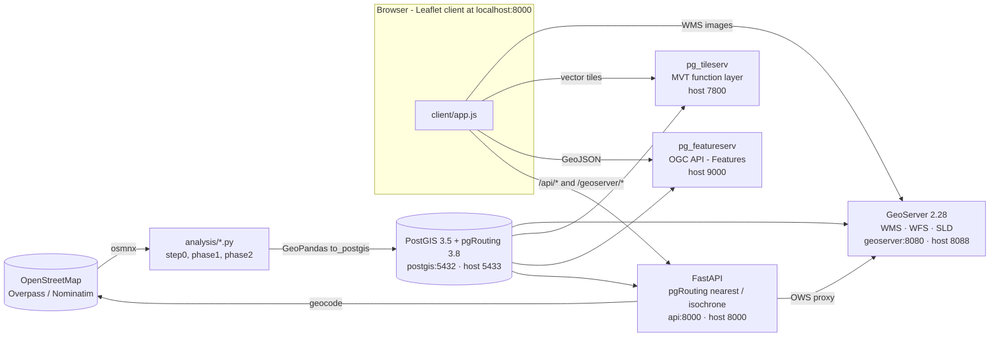

# Kochi Healthcare WebGIS

Walking access to healthcare in three adjacent wards of Kochi Municipal Corporation, Kerala (**Edappally, Palarivattom, Kaloor**). This is a full spatial-analytics and map-publishing stack: OSM data goes through PostGIS and network analysis, then out through GeoServer, pg_tileserv, pg_featureserv and a FastAPI + Leaflet client.

It upgrades the earlier `nearby-services` project (FastAPI + PostGIS `geography` + Nominatim + Leaflet), where "nearby" meant straight-line distance. Here "nearby" means **walking time on the street network**.

| Parameter | Value |
|---|---|
| Study area | 20.8 km² around 10.008° N, 76.302° E (4.0 × 5.2 km rectangle approximating the three wards) |
| Service | Healthcare: `amenity=hospital`, `amenity=clinic`, `amenity=doctors`, `healthcare=*` (93 OSM features) |
| Walking threshold | 15 min = 1.2 km at **4.8 km/h**; sensitivity at **3.6 km/h** (elderly, 900 m) |
| CRS | Storage and web: `EPSG:4326`; measurement: UTM 43N `EPSG:32643`; tiles: `EPSG:3857` |
| Data | 5,321 building footprints; walk network of 11,665 nodes and 27,936 edges (study area + 2 km) |

Results and discussion: **[ANSWERS.md](ANSWERS.md)**. Study notes: [`study/S1.md`](study/S1.md) to [`study/S4.md`](study/S4.md).

---

## Architecture



Containers talk to each other only through Docker service names on the `kochi_webgis_net` bridge network (`postgis`, `geoserver`, `pg_tileserv`, `pg_featureserv`, `api`). Host ports exist only for the browser, psql and the analysis scripts.

## Repository layout

```
kochi-healthcare-webgis/
├── README.md, ANSWERS.md
├── docker-compose.yml, .env.example, .dockerignore
├── study/            S1–S4 study notes (OGC services, tiles/indexes, accessibility, containers)
├── sql/              00_init_extensions.sql, phase1_q1_q3.sql, phase3_views.sql
├── sld/              GeoServer styles (6 SLDs)
├── analysis/         step0_verify_kochi.py, phase1_etl.py, phase2_network.py,
│                     phase3_publish_geoserver.py, phase3_verify_stack.py, requirements.txt
├── api/              FastAPI app, requirements.txt, multi-stage Dockerfile
├── client/           Leaflet client (index.html, app.js, style.css)
├── k8s/              Kubernetes manifests (final phase)
└── .github/workflows/ CI (final phase)
```

## Prerequisites (Windows 11)

- Docker Desktop (WSL 2 backend), running
- Python 3.11 or newer, with a project virtual environment `.venv`
- About 3 GB of free disk space for images and volumes; internet access for OSM, Nominatim and the CDN-hosted Leaflet

## Run everything from scratch (PowerShell)

```powershell
cd F:\Kochi-healthcare-webgis
Copy-Item .env.example .env          # then edit passwords and NOMINATIM_USER_AGENT
docker compose up -d --build
python -m venv .venv
.\.venv\Scripts\Activate.ps1
pip install -r analysis\requirements.txt "sqlalchemy>=2.0" "geoalchemy2>=0.14" "psycopg2-binary>=2.9"

python analysis\step0_verify_kochi.py                       # study area + >=15 features check
python analysis\phase1_etl.py                               # OSM -> PostGIS (4326 + 32643)
docker exec -i kochi_postgis psql -U webgis -d kochi_health -v ON_ERROR_STOP=1 -f /sql/phase1_q1_q3.sql
python analysis\phase2_network.py                           # walking access + service areas
docker exec -i kochi_postgis psql -U webgis -d kochi_health -v ON_ERROR_STOP=1 -f /sql/phase3_views.sql
python analysis\phase3_publish_geoserver.py                 # GeoServer layers + OGC evidence
docker compose restart pg_tileserv pg_featureserv           # pick up new tables/functions
python analysis\phase3_verify_stack.py                      # 18 end-to-end checks
start http://localhost:8000
```

## Services

| Service | Browser / host URL | Inside Docker |
|---|---|---|
| WebGIS client + API | http://localhost:8000 (API docs: `/docs`) | `api:8000` |
| GeoServer | http://localhost:8088/geoserver/web | `geoserver:8080` |
| pg_tileserv | http://localhost:7800 | `pg_tileserv:7800` |
| pg_featureserv | http://localhost:9000 | `pg_featureserv:9000` |
| PostGIS | `localhost:5433` (psql, QGIS, scripts) | `postgis:5432` |

## API

| Endpoint | Purpose |
|---|---|
| `GET /api/health` | PostGIS, pgRouting and GeoServer status |
| `GET /api/config` | Public service URLs and study-area extent for the client |
| `GET /api/geocode?q=` | Nominatim search biased to the study area (1 request/s, cached) |
| `GET /api/nearest?lat&lon&facility_set=all\|clinical\|hospital&k=5&speed_kmh=4.8` | k nearest facilities by **network** walking distance (pgRouting `pgr_dijkstraCost`) and the route to the best one (`pgr_dijkstra`) |
| `GET /api/isochrone?lat&lon&minutes=15&speed_kmh=4.8` | Walking service area from any point (`pgr_drivingDistance`), with building and facility counts |
| `GET /api/stats/coverage[?facility_set=]` | Phase 2 coverage table (`v_coverage_summary`) |
| `GET /api/facilities/{id}` | One facility with its accessibility attributes |
| `GET/POST /geoserver/{ws}/{ows\|wms\|wfs\|wcs}` | Same-origin GeoServer OWS proxy (other GeoServer paths are refused) |

## Published layers

| GeoServer layer (`kochi:`) | PostGIS source | Style |
|---|---|---|
| `study_area` | `study_area_4326` | `study_area.sld` |
| `healthcare` | `facility_access_4326` | `healthcare_points.sld` (by type, labels below 1:12,000) |
| `service_areas` | `service_areas_4326` | `service_areas.sld` (filter with `CQL_FILTER=facility_set='all' AND speed_kmh=4.8`) |
| `building_access` | `building_access_4326` | `building_access.sld` (walking-time band, all facilities at 4.8 km/h) |
| `walk_edges` | `walk_edges_4326` | `walk_edges.sld` (visible below 1:40,000) |
| `hospital_access_gaps` | view `v_hospital_access_gaps_4326` | `hospital_access_gaps.sld` |

pg_tileserv function layer: `http://localhost:7800/public.building_walk_time/{z}/{x}/{y}.pbf?facility_set=hospital&speed_kmh=3.6`, which accepts any speed from 1 to 8 km/h.
pg_featureserv: `http://localhost:9000/collections/public.facility_access_4326/items.json?limit=100`.

## Key results (details in ANSWERS.md)

- 15-minute walk at 4.8 km/h: **97.31 %** of buildings reach some healthcare point, **96.47 %** a clinical facility and **87.16 %** a hospital-tagged facility.
- At the elderly speed of 3.6 km/h, hospital coverage drops to **68.33 %**, leaving **1,685 buildings** more than 900 m from a hospital-tagged facility.
- Straight-line buffers overstate 5-minute access by up to **39 percentage points**.
- In Web Mercator the study area is **3.77 %** too large compared with the ellipsoid. UTM 43N is within **0.03 %**.
- A GiST index turns the 500 m building-count query from about 509 ms into about 39 ms (warm cache). `ST_Distance < r` cannot use the index.

## Troubleshooting

| Symptom | Fix |
|---|---|
| `kochi_api` keeps restarting | Run `docker compose logs api`. Usually a wrong `POSTGRES_PASSWORD` in `.env`, or `phase2_network.py` has not been run yet |
| Map shows no buildings (vector tiles) | Run `sql/phase3_views.sql`, then `docker compose restart pg_tileserv`, and check that http://localhost:7800 lists `public.building_walk_time` |
| WMS layers missing or pink tiles | Run `python analysis\phase3_publish_geoserver.py` and check http://localhost:8088/geoserver/web → Layer Preview |
| Geocoder returns 502 | Nominatim is unreachable or rate-limited. Set a real contact in `NOMINATIM_USER_AGENT`, wait a minute, retry |
| "Point is … m from the walk network" | The clicked point is outside the analysed network. Click inside the study area |
| Port already in use | Change `*_PORT` in `.env`, then `docker compose up -d` |

## Data and licences

Map data © OpenStreetMap contributors, available under the Open Database License (ODbL). Geocoding by Nominatim (usage policy: at most 1 request per second, identifying User-Agent). Basemaps © OpenStreetMap contributors and © CARTO.
