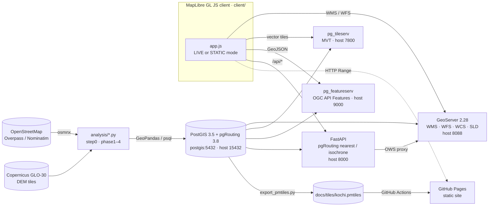

# Kochi Healthcare WebGIS

Walking access to healthcare in three adjacent wards of Kochi Municipal Corporation, Kerala: **Edappally, Palarivattom and Kaloor**. This is a full spatial-analytics and map-publishing system:

- OpenStreetMap data → PostGIS / pgRouting network analysis
- published through GeoServer (WMS · WFS · WCS), pg_tileserv (vector tiles), pg_featureserv (OGC API – Features) and a FastAPI service
- shown in a MapLibre GL JS client that runs against the live stack, in a local Kubernetes cluster, or **serverless on GitHub Pages** from a single PMTiles file.

It upgrades the earlier `nearby-services` project (FastAPI + PostGIS `geography` + Nominatim + Leaflet), where "nearby" meant straight-line distance. Here "nearby" means **walking time on the street network**.

| Parameter | Value |
|---|---|
| Study area | 20.8 km² around 10.008° N, 76.302° E (4.0 × 5.2 km rectangle approximating the three wards) |
| Service | Healthcare: `amenity=hospital`, `amenity=clinic`, `amenity=doctors`, `healthcare=*` (93 OSM features) |
| Walking threshold | 15 min = 1.2 km at **4.8 km/h**; sensitivity at **3.6 km/h** (elderly, 900 m) |
| CRS | Storage and web: `EPSG:4326`; measurement: UTM 43N `EPSG:32643`; tiles: `EPSG:3857` |
| Data | 5,321 building footprints; walk network of 11,665 nodes and 27,936 edges (study area + 2 km); Copernicus GLO-30 DEM |

Results and discussion (Q1–Q12): **[ANSWERS.md](ANSWERS.md)**. Study notes: [`study/S1.md`](study/S1.md)–[`study/S4.md`](study/S4.md).

---

## Architecture



The same code runs three ways:

| Run mode | Where | What runs |
|---|---|---|
| **Docker Compose** | `docker-compose.yml` | All 5 services; containers reach each other by service name (`postgis`, `geoserver`, `pg_tileserv`, `pg_featureserv`, `api`) on `kochi_webgis_net` |
| **Kubernetes (kind)** | `k8s/` | PostGIS StatefulSet + PVC, API (2 replicas), pg_tileserv, pg_featureserv; pods use the `postgis` Service. GeoServer stays in Compose |
| **Static (GitHub Pages)** | `.github/workflows/deploy-pmtiles.yml` | No servers: the client reads `kochi.pmtiles` with HTTP Range requests |

## Repository layout

```
Kochi-healthcare-webgis/
├── README.md, ANSWERS.md, docker-compose.yml, .env.example, .dockerignore
├── study/              S1–S4 study notes
├── sql/                00_init_extensions.sql, phase1_q1_q3.sql, phase3_views.sql
├── sld/                GeoServer styles (7 SLDs incl. dem_elevation.sld)
├── analysis/           step0, phase1_etl, phase2_network, phase3_*, phase4_dem_geoserver + outputs/evidence
├── api/                FastAPI app, requirements.txt, multi-stage Dockerfile (Q10)
├── client/             MapLibre client: index.html, app.js, style.css
├── k8s/                kind-config.yaml + namespace, secret, PostGIS StatefulSet, app Deployments (Q11)
├── pmtiles/            export_pmtiles.py, build_site.py, serve_static.py (Q12)
├── docs/tiles/         kochi.pmtiles + kochi_static.json (committed; published by CI)
└── .github/workflows/  deploy-pmtiles.yml
```

## Prerequisites (Windows 11)

- Docker Desktop (WSL 2 backend) running
- Python 3.11+ with a project virtual environment `.venv`
- For Kubernetes: `kind` and `kubectl` on `PATH` (e.g. `winget install Kubernetes.kind Kubernetes.kubectl`)
- Internet access for OSM, Nominatim, Copernicus tiles and the CDN-hosted MapLibre / pmtiles libraries

## 1 · Docker Compose quick start

```powershell
cd F:\Kochi-healthcare-webgis
Copy-Item .env.example .env            # edit passwords and NOMINATIM_USER_AGENT
docker compose up -d --build
docker compose ps                      # 5 services, all "healthy"

python -m venv .venv
.\.venv\Scripts\Activate.ps1
pip install -r analysis\requirements.txt "sqlalchemy>=2.0" "geoalchemy2>=0.14" "psycopg2-binary>=2.9" "rasterio>=1.3" h3 -r pmtiles\requirements.txt

python analysis\step0_verify_kochi.py
python analysis\phase1_etl.py
docker exec -i kochi_postgis psql -U postgres -d kochi_health -v ON_ERROR_STOP=1 -f /sql/phase1_q1_q3.sql
python analysis\phase2_network.py
docker exec -i kochi_postgis psql -U postgres -d kochi_health -v ON_ERROR_STOP=1 -f /sql/phase3_views.sql
python analysis\phase3_publish_geoserver.py
python analysis\phase3_q5_q7_evidence.py
python analysis\phase4_dem_geoserver.py
docker compose restart pg_tileserv pg_featureserv
python analysis\phase3_verify_stack.py
start http://localhost:8000
```

| Service | Host URL | Inside Docker |
|---|---|---|
| MapLibre client + API (`/docs` for OpenAPI) | http://localhost:8000 | `api:8000` |
| GeoServer | http://localhost:8088/geoserver/web | `geoserver:8080` |
| pg_tileserv | http://localhost:7800 | `pg_tileserv:7800` |
| pg_featureserv | http://localhost:9000 | `pg_featureserv:9000` |
| PostGIS | `127.0.0.1:15432` (user `postgres`, db `kochi_health`) | `postgis:5432` |

## 2 · Kubernetes (kind) quick start

```powershell
cd F:\Kochi-healthcare-webgis
docker build -f api/Dockerfile --target runtime -t kochi-healthcare-api:latest .
kind create cluster --config k8s/kind-config.yaml          # cluster "kochi-webgis"
kind load docker-image kochi-healthcare-api:latest pgrouting/pgrouting:16-3.5-3.8 pramsey/pg_tileserv:latest pramsey/pg_featureserv:latest --name kochi-webgis
kubectl apply -f k8s/00-namespace.yaml -f k8s/10-secret-example.yaml -f k8s/20-postgis-statefulset.yaml
kubectl -n kochi-webgis rollout status statefulset/postgis --timeout=300s
# copy the analysed database from Compose into the cluster (see ANSWERS.md Q11 for the full sequence)
kubectl apply -f k8s/30-app-deployments.yaml
kubectl get pods,svc,pvc -n kochi-webgis
start http://localhost:18080
```

Host ports: API + client **18080**, pg_tileserv **17800**, pg_featureserv **19000**. They differ from the Compose ports, so both stacks can run side by side. Self-healing test: `kubectl delete pod -n kochi-webgis -l app=api --wait=false` (replicas come back with new names) and `kubectl delete pod -n kochi-webgis postgis-0` (same name, same PVC, data intact).

## 3 · GitHub Pages (static PMTiles)

```powershell
python pmtiles\export_pmtiles.py        # PostGIS 127.0.0.1:15432 -> docs/tiles/kochi.pmtiles + kochi_static.json
python pmtiles\build_site.py            # client + tiles -> _site/
python pmtiles\serve_static.py          # http://localhost:8090 (Range-capable, like GitHub Pages)
```

Commit `docs/tiles/` and push to `main`. In the GitHub repository go to **Settings → Pages → Source: GitHub Actions**. The workflow `deploy-pmtiles.yml` validates the archive, assembles `_site/` and deploys it. When `/api/config` is unreachable, the client shows **STATIC · PMTiles** and keeps buildings by walking time (any facility set and speed), facilities, service areas, gap buildings and H3 grids. Routing, geocoding, WMS/WFS and the DEM need the live stack. Force a mode with `?mode=static` or `?mode=live`.

## API

| Endpoint | Purpose |
|---|---|
| `GET /api/health` | PostGIS, pgRouting and GeoServer status |
| `GET /api/config` | Public service URLs and study-area extent (its absence switches the client to static mode) |
| `GET /api/geocode?q=` | Nominatim search biased to the study area (1 request/s, cached) |
| `GET /api/nearest?lat&lon&facility_set=all\|clinical\|hospital&k=5&speed_kmh=4.8` | k nearest facilities by network walking distance (`pgr_dijkstraCost`) and the route (`pgr_dijkstra`) |
| `GET /api/isochrone?lat&lon&minutes=15&speed_kmh=4.8` | Walking service area from any point (`pgr_drivingDistance`) |
| `GET /api/stats/coverage[?facility_set=]` | Phase 2 coverage table |
| `GET /api/facilities/{id}` | One facility with its accessibility attributes |
| `GET/POST /geoserver/{ws}/{ows\|wms\|wfs\|wcs}` | Same-origin GeoServer OWS proxy (other GeoServer paths are refused) |

## Key results (details in ANSWERS.md)

- 15-minute walk at 4.8 km/h: **97.31 %** of buildings reach some healthcare point, **96.47 %** a clinical facility and **87.16 %** a hospital-tagged facility. At 3.6 km/h hospital coverage falls to **68.33 %**.
- Straight-line buffers understate the unserved building area 26-fold (0.09 % vs 2.37 % network). H3 res 8 doubles it again (5.31 %), a MAUP scale effect.
- For 1 in 3 random points the straight-line nearest facility is not the walking-nearest. The median network/straight ratio is 1.56.
- WMS 1.3.0 with lon,lat order for EPSG:4326 returns an empty image (12,098 vs 270,216 bytes). GML 3.2 is 2.64× larger than GeoJSON.
- In Web Mercator the study area is 3.77 % too large. A GiST index makes the 500 m building query about 13× faster (warm cache).

## Troubleshooting

| Symptom | Fix |
|---|---|
| Client shows STATIC on http://localhost:8000 | The API can't answer `/api/config`; see `docker compose logs api` (often a wrong DB password in `.env`) |
| No buildings in live mode | Run `sql/phase3_views.sql`, then `docker compose restart pg_tileserv` |
| WMS layers or DEM missing | Run `python analysis\phase3_publish_geoserver.py` / `python analysis\phase4_dem_geoserver.py` |
| kind API pods not Ready | The cluster database is empty: run the restore step in ANSWERS.md Q11, then `kubectl -n kochi-webgis rollout restart deploy` |
| `ErrImageNeverPull` in kind | `kind load docker-image kochi-healthcare-api:latest --name kochi-webgis` |
| Static site shows nothing locally | Serve with `pmtiles\serve_static.py`, not `python -m http.server` (PMTiles needs Range requests) |
| Port already in use | Change the `*_PORT` values in `.env`, or the `hostPort` values in `k8s/kind-config.yaml` (recreate the cluster) |

## Data and licences

Map data © OpenStreetMap contributors (ODbL). DEM: Copernicus GLO-30, produced using Copernicus WorldDEM-30 © DLR e.V. 2010–2014 and © Airbus Defence and Space GmbH 2014–2018, provided under COPERNICUS by the European Union and ESA. Geocoding by Nominatim (max 1 request/s, identifying User-Agent). Basemap tiles © OpenStreetMap contributors.
