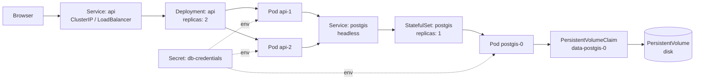

# S4 — Containers, Compose and Kubernetes

## Image vs container
An **image** is a read-only template: a filesystem snapshot plus metadata (default command, exposed ports, environment). A **container** is a running instance of an image with a thin writable layer on top. One `pgrouting/pgrouting` image can start many independent containers, the way one class creates many objects. When a container is removed, its writable layer goes with it, so anything worth keeping must live in a **volume**.

## Dockerfile layers and multi-stage builds
Each Dockerfile instruction (`FROM`, `RUN`, `COPY`) produces a cached layer. Docker reuses a cached layer until that instruction or its inputs change, and then rebuilds that layer and every one after it. So order the file from least to most frequently changing: copy `requirements.txt` and `pip install` *before* copying the application code, and a code edit will no longer reinstall every package. A **multi-stage build** uses one stage with compilers and build tools, then copies only the finished artefacts into a small runtime stage (e.g. `python:3.12-slim`). The result is a smaller image with less attack surface and no build tooling in production.

## Docker Compose
Compose describes a multi-container application in one YAML file: services, the network they share, volumes, environment variables, healthchecks and start-up order (`depends_on: condition: service_healthy`). Compose's internal DNS resolves service names, so GeoServer reaches the database at `postgis:5432`, not `localhost`. Inside a container, `localhost` means that container itself.

## Kubernetes objects

- **Pod**: the smallest deployable unit, one or more containers sharing an IP and volumes. Pods are disposable.
- **Deployment**: keeps N identical, stateless Pods running and handles rolling updates. Used for the FastAPI app, pg_tileserv and pg_featureserv.
- **StatefulSet**: like a Deployment, but each Pod gets a stable name (`postgis-0`) and its *own* PersistentVolumeClaim that follows it across restarts. This is the right object for databases.
- **Service**: a stable DNS name and virtual IP in front of a changing set of Pods (selected by label). It plays the same role as a Compose service name.
- **Secret**: holds passwords and keys, injected as environment variables or files. Values are only base64-encoded, not encrypted, unless encryption at rest is enabled, so never commit a real Secret to Git.
- **PersistentVolumeClaim (PVC)**: a Pod's request for storage ("10 Gi, ReadWriteOnce"). The cluster binds it to a PersistentVolume.

## Self-healing and persistent database storage
Kubernetes is *declarative*: you state the desired state ("2 api replicas") and controllers continually reconcile reality toward it. If a Pod crashes, or its **liveness probe** fails, it is restarted. If a node dies, its Pods are rescheduled elsewhere. A **readiness probe** keeps traffic away from a Pod until it can actually serve. For PostGIS, self-healing is only safe because the data does not live in the Pod. When `postgis-0` is recreated, the StatefulSet re-attaches the same PVC and the database starts with every table intact. Compose's named volume `kochi_pgdata` plays the same role on a single machine.
